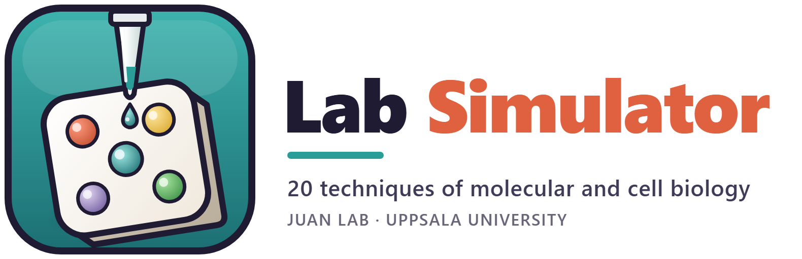

# Lab Simulator

A board game of 20 hands-on minigames on the core techniques of molecular and cell biology,
from PCR to zebrafish microinjection. Roll the die, walk around the lab, and at each bench
do the technique yourself: find the reagents in the freezer before your fingers freeze,
calculate a master mix that does not run out, load a gel without shaking, stop the
electrophoresis before the dye runs off the end, sort cells, focus a microscope, inject a
zebrafish embryo before it divides. Every step ends with a true fact about the technique,
and every technique has its own music.

Made by the [Juan Lab](https://juanlab.org), Uppsala University.

## Play

**Windows:** double-click `LabSimulator.exe` (built by `build_windows.bat`; not code-signed, so Windows may
show a "Windows protected your PC" notice the first time: choose *More info*, then *Run anyway*).

**From source (any system):** install Python 3.10+ and run
`pip install pygame-ce numpy`, then `python game/main.py`
(on macOS you can double-click `run_from_source.command`).

To build a download: `build_windows.bat` on Windows, `build_mac.command` on a Mac.
Pushing a tag such as `v1.0` to GitHub builds both automatically and attaches them to a release
(see `.github/workflows/release.yml`).

## How the game works

- **The board.** 28 benches in a loop: 20 techniques in four wings (DNA, Genes & genomes,
  Proteins, Cells & embryos) and 8 special benches.
  *Start* renews your grant (+1 coffee each lap). *Lab notebook* gives a fact.
  *Seminar* asks a question (right answer: +1 coffee). *Coffee* gives a coffee.
  *Contamination* sends you back three benches. *Conference* lets you play any technique.
- **Coffee.** After a roll, spend a coffee to move one bench more or less. Coffee also comes from a
  flawless run (90 or more on every step) and from passing all five techniques of a wing.
- **Levels.** Each bench offers Student (more time, wider margins, at most 2 stars), Researcher and
  Expert (less time, tighter margins). Passing at Expert puts a gold seal on the bench.
- **A technique** is a run of 3 to 6 steps. Each step scores up to 100; the average gives
  1 star (40), 2 stars (65) or 3 stars (85).
- **Ranks** follow your total stars (out of 60): Summer student, Master's student, PhD student,
  Postdoc, Group leader, Professor, Nobel laureate.
- **Pass all 20 techniques** (at least one star each) to get your own lab.
- **Lab notebook** (Tab on the board) keeps every fact you have read.
  **Protocol binder** replays any technique you have played. **Free play** on the title screen
  opens every technique without saving.

The techniques and their minigames are listed in [DESIGN.md](DESIGN.md).

## Controls

| Input | Action |
| --- | --- |
| Mouse | Everything: pipetting, clicking, dragging, aiming |
| Space / Enter | Stop a timed process, confirm, roll the die |
| Number keys | Answer questions, type volumes |
| Arrow keys | Menus; some minigames say so |
| Esc | Pause |
| Tab (on the board) | Lab notebook |
| F11 | Full screen |

Progress is saved automatically (3 notebooks) in `%APPDATA%\LabSimulator` on Windows and
`~/Library/Application Support/LabSimulator` on macOS.

## Code

Plain Python with pygame-ce and numpy; no image or sound files. Everything is drawn and
synthesised in code, with a realistic rendering layer (`game/real.py`) for lab plastics, glass,
steel, instrument screens and the photographic lab background.

| File | Contents |
| --- | --- |
| `game/main.py` | Entry point, menus, notebook, binder, ending |
| `game/board.py` | The board, dice, special benches |
| `game/station.py` | Runs one technique: intro, steps, results |
| `game/stage.py` | Minigame base class and the shared types (quiz, order, calc, stop, match) |
| `game/techniques.py` | Gathers the 20 techniques from the four wing modules |
| `game/tech_dna.py`, `tech_genes.py`, `tech_proteins.py`, `tech_cells.py` | The four wings, each gathering five per-technique modules (`dna_pcr.py`, `genes_crispr.py`, `proteins_elisa.py`, `cells_inject.py`, ...) |
| `game/*_common.py`, `game/genes_embryo.py` | Drawing helpers shared within a wing (gels, instrument screens, chromatograms, microscope fields, the zebrafish embryo) |
| `game/audio.py` | Procedural music (one tune per technique) and sound effects |
| `game/gfx.py`, `game/render.py` | Drawing: anti-aliased shapes, shading, soft shadows, glows, procedural textures, lab objects, backgrounds |
| `game/core.py` | Palette, input, text, saving |
| `logo/` | Logo masters (`emblem.svg`, `logo.svg`) and renders; `python make_icon.py` makes the game icons and title logo from them |
| `tests/run_stages.py` | Plays every minigame with random input and checks it finishes |
| `tests/run_game.py` | Plays the whole game headless |

Run the tests from this folder: `python tests/run_stages.py` and `python tests/run_game.py`.
After changing a technique, `python make_design.py` regenerates DESIGN.md.
